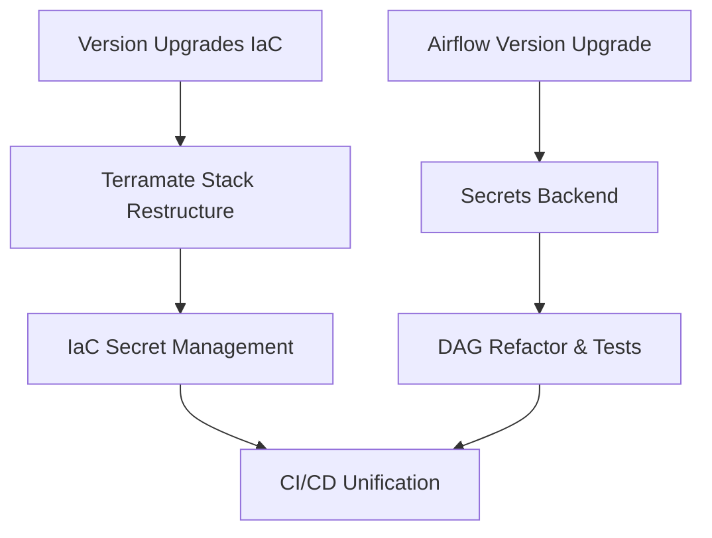

# MLOps Platform — Comprehensive Refactor Plan

> *Estimated costs for executing this plan:*
> **Current Model** (Claude 4.6 Sonnet): ~444k input / ~144k output | **$3.49 – $5.24**
> **Auto Model**: (Same token usage) | **$1.42 – $2.13**

---

## 1. IaC — Introduce Terramate (`mlops-mlplatform-on-eks`)

### Why Terramate?

The current structure is a single root module calling all child modules, with **one shared state file**. Terramate converts each logical unit into an isolated **stack** with its own state, enables change detection (only re-plan what changed), and generates repetitive boilerplate (backend config, provider blocks) from templates — keeping things DRY without Terragrunt's DSL overhead. It is open source (MPL-2.0, v0.15.4).

### Proposed Stack Layout

```
deployment/
├── terramate.tm.hcl          # Root config: backend template, globals
├── stacks/
│   ├── bootstrap/            # S3 + DynamoDB for remote state
│   ├── vpc/                  # VPC, subnets, NAT
│   ├── eks/                  # EKS cluster + node groups
│   ├── eks-addons/           # Autoscaler, EBS/EFS CSI
│   ├── networking/           # ALB controller, External-DNS
│   ├── rds/                  # RDS PostgreSQL + MySQL
│   ├── external-secrets/     # ESO installation
│   ├── airflow/              # Airflow Helm + IAM
│   ├── mlflow/               # MLflow Helm + IAM
│   ├── jupyterhub/           # JupyterHub Helm
│   ├── monitoring/           # Prometheus + Grafana
│   ├── sagemaker/            # ECR + SageMaker resources
│   ├── dashboard/            # Vue.js dashboard Helm
│   └── user-profiles/        # IAM user/role management
└── modules/                  # Reusable Terraform modules (unchanged)
```

Each stack gets its own `stack.tm.hcl` with metadata and dependencies, and Terramate generates the `backend.tf` + `providers.tf` per stack from root globals.

### Terramate Features to Use

- `**terramate run --changed**` in CI — only re-applies stacks with changes
- **Code generation** (`generate_hcl` blocks) for backend config and provider blocks per stack
- `**globals`** for shared values (region, project name, state bucket)
- `**after`/`before`** ordering constraints replacing implicit module `depends_on`

---

## 2. IaC — Version Upgrades


| Component                | Current    | Target                               |
| ------------------------ | ---------- | ------------------------------------ |
| Terraform                | `>= 1.5.3` | `>= 1.10.0` (or OpenTofu `>= 1.9.0`) |
| AWS provider             | `5.11.0`   | `~> 6.0`                             |
| Helm provider            | `2.10.1`   | `~> 2.17`                            |
| Kubernetes provider      | `2.22.0`   | `~> 2.35`                            |
| EKS module               | `19.5.1`   | `~> 21.0`                            |
| EKS cluster version      | `1.24`     | `1.32`                               |
| VPC module               | `5.0.0`    | `~> 5.19`                            |
| IAM module               | `5.11.1`   | `~> 5.52`                            |
| Airflow Helm chart       | `8.7.1`    | `~> 8.9` (community)                 |
| JupyterHub Helm chart    | `2.0.0`    | `~> 3.3`                             |
| Cluster Autoscaler chart | `9.10.7`   | `~> 9.43`                            |
| ALB controller chart     | `1.4.1`    | `~> 1.11`                            |


**Note on Terraform vs OpenTofu**: OpenTofu 1.11.0 is the fully open source fork (MPL-2.0). If open-source licensing is a priority, migrating to OpenTofu is a drop-in replacement; otherwise Terraform 1.10+ is fine.

---

## 3. IaC — Secret Management Improvements

Current state: a mix of inline Helm values with secrets, `kubernetes_secret` resources in Terraform, and ad-hoc Airflow variables. External Secrets Operator is already installed but only partially used (MLflow module).

**Target state**: All secrets flow through **AWS Secrets Manager → External Secrets Operator → Kubernetes Secrets**. No plaintext secrets in Terraform state or Helm values.

Changes:

- Add `aws_secretsmanager_secret` resources in each stack for that module's secrets (DB passwords, OAuth client secrets, Fernet key, etc.)
- Extend `ClusterSecretStore` (already exists) to cover all namespaces
- Add `ExternalSecret` manifests in each module's Helm chart / Terraform for Airflow, JupyterHub, Grafana OAuth creds, RDS passwords
- Remove `kubernetes_secret` Terraform resources that embed plaintext values
- Add a `tfvars.example` per stack (never commit actual `.tfvars`)

---

## 4. Airflow — Version Upgrade (`mlops-airflow-DAGs`)


| Component         | Current                     | Target                      |
| ----------------- | --------------------------- | --------------------------- |
| Apache Airflow    | `2.6.1 / 2.6.2`             | `3.0.1`                     |
| Python base image | `python:3.11.3-slim-buster` | `python:3.12-slim-bookworm` |
| TensorFlow        | `2.11.0 / 2.12.0`           | `2.17.0`                    |
| Keras             | `2.11.0 / 2.12.0`           | `3.7.0`                     |
| MLflow            | `2.2.2 / 2.4.0`             | `2.19.0`                    |
| boto3             | `1.26.67`                   | `~> 1.37`                   |
| scikit-learn      | `1.2.0`                     | `1.6.1`                     |
| pre-commit hooks  | black `22.6.0`              | black `24.x`, ruff added    |


Airflow 3.0 has a new **Task SDK** architecture where task code is decoupled from the scheduler. The `@task.kubernetes` and `@task.docker` decorators are still present but the task process model changes. The DAGs will need:

- Update `@task.kubernetes` / `@task.docker` decorator imports (new provider package names in 3.0)
- Replace deprecated `Variable.get()` calls with the new `dag.params` / `airflow.sdk` patterns
- Remove the `airflow.models.xcom` import changes
- Consolidate the three `requirements.txt` / `pyproject.toml` / `Docker/requirements.txt` into a single source of truth using Poetry workspace or a shared `pyproject.toml`

---

## 5. Airflow — Secrets Backend

Current: Docker DAG reads secrets from `os.getenv()` (plain env vars). K8s DAGs reference Kubernetes Secrets by name hardcoded in the DAG file.

**Target**: Use the **Airflow Kubernetes Secrets Backend** (new in `apache-airflow-providers-cncf-kubernetes` 3.0 era), which allows Airflow to read `Connections` and `Variables` directly from Kubernetes Secrets — eliminating hardcoded secret names in DAGs and supporting ESO-managed secrets transparently.

Changes to `[cnn_skin_cancer/airflow_k8s_workflow_DAG.py](../mlops-airflow-DAGs/cnn_skin_cancer/airflow_k8s_workflow_DAG.py)`:

- Remove explicit `Secret(...)` object construction and `secrets=` parameters
- Connections (`aws_default`) stored in K8s Secrets, read via secrets backend
- Airflow `Variables` (`MLFLOW_TRACKING_URI`, etc.) stored in K8s Secrets

Airflow config in the Helm chart (`mlops-mlplatform-on-eks`) updated:

```ini
[secrets]
backend = airflow.providers.cncf.kubernetes.secrets.kube_secrets.KubernetesSecretBackend
```

For the Docker DAG, migrate to `airflow.providers.cncf.kubernetes.operators.pod.KubernetesPodOperator` (replacing the Docker operator for production parity).

---

## 6. Airflow — DAG & Code Quality

- **Add unit tests**: `pytest` + `pytest-airflow` to validate DAG structure, task counts, dependencies
- **Fix version mismatches**: Single `pyproject.toml` at repo root as the authoritative source; Docker `requirements.txt` generated/locked from it
- **Pre-commit**: Upgrade to `ruff` (replaces black + isort), add `hadolint` for Dockerfile linting, bump `pre-commit-hooks` to v5.x
- **CI**: Add a DAG import validation step to the GitHub Actions workflow (Airflow `--test-mode`)

---

## 7. CI/CD Improvements

`**mlops-mlplatform-on-eks`**: Replace the two conflicting workflow files (`terraform-ci.yaml` + `terraform.yml`) with a single workflow using `terramate run --changed` to only plan/apply changed stacks. Add OIDC-based AWS auth (no long-lived access keys).

`**mlops-airflow-DAGs`**: Add a test stage running `pytest` DAG validation tests, and pin the Docker build to produce both `latest` and a semver-tagged image.

---

## Implementation Order




